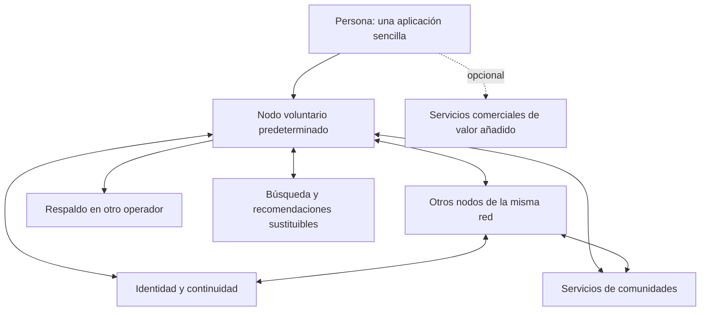

# Spartakos

Nombre provisional de la red: **Spartakos**.

## 0. Naturaleza del documento

Esta especificación consolida el trabajo exploratorio y organiza una propuesta de producto, arquitectura, gobierno, operación y desarrollo. Su cobertura temática no implica que el diseño funcional esté completo. El análisis se amplía por bloques antes de seleccionar componentes o ejecutar el laboratorio. Las decisiones técnicas anteriores permanecen como candidatas documentales.

Las expresiones «debe» y «no debe» describen el comportamiento exigido por esta propuesta. Las decisiones provisionales pueden modificarse en la revisión. Ninguna cifra de capacidad es una prestación ya medida. Existe un simulador local experimental; no hay red distribuida operativa ni presupuesto de despliegue.

La especificación vigente prevalece sobre los documentos exploratorios. Los anexos detallan pruebas, decisiones y antecedentes. PROPUESTA.md es un borrador histórico y no constituye la Constitución del proyecto.

### 0.1 Requisitos del proyecto

| Código | Requisito |
| --- | --- |
| R01 | Soberanía sobre identidad y publicaciones; portabilidad y derecho a irse |
| R02 | Máxima independencia y descentralización prácticas, sin imponer complejidad al usuario |
| R03 | Base distribuida de iniciativas voluntarias gratuitas; servicios comerciales opcionales que aporten valor y no sean imprescindibles |
| R04 | Experiencia sencilla para personas que llegan individualmente, con pocas decisiones y configuraciones obligatorias |
| R05 | Llegada desde redes populares superando la pérdida de historial y contactos; interoperabilidad externa no requerida |
| R06 | Comunidades privadas y parcialmente públicas, con distintos permisos de participación |
| R07 | Libertad algorítmica bajo control de personas y, en su ámbito, comunidades |
| R08 | Intereses privados y públicos; reputación contextual por especialidades o temas, discreta y sin presión por aumentarla |
| R09 | Pluralidad de proveedores, incluida la posibilidad de publicidad voluntaria con contraprestación |
| R10 | Constitución para la sociedad virtual y prevención de los inconvenientes de iniciativas anteriores |
| R11 | Código abierto y posibilidad de desarrollo colectivo desde el inicio del desarrollo; se descarta esperar a una versión operativa |
| R12 | Diseñar para utilidad y autonomía de atención, sin buscar dependencia emocional; evaluar interacciones por su función, sin presuponer «me gusta» |
| R13 | Transformar una comunidad privada en pública requiere unanimidad expresa de todos sus integrantes, incluso preservando el historial |
| R14 | La iniciativa promotora no confiere propiedad ni control perpetuo; la continuidad exige administración sustituible y mecanismos efectivos de sucesión y alojamiento |

La arquitectura híbrida con funciones sustituibles es la hipótesis de trabajo. La marca de cuenta «huérfana» es una función experimental pendiente de criterios y procedimiento.

### 0.2 Límites expresos

La migración de entrada es individual y procede de redes populares. La comunicación entre operadores de esta red forma parte de su arquitectura distribuida; la federación con redes ajenas queda fuera del alcance.

No se promete almacenamiento infinito, eliminación de cualquier copia externa, anonimato absoluto, disponibilidad sin recursos ni recuperación cuando no existe prueba suficiente de control.

### 0.3 Diseño funcional por bloques

La [síntesis funcional](REVISION-FUNCIONAL.md) reúne diez bloques de comportamiento y sus decisiones pendientes. Se ha completado una primera pasada documental; la revisión funcional y las pruebas de recorridos preceden a la selección definitiva de componentes y a la ejecución del laboratorio. Los análisis técnicos previos permanecen como candidatos, no como decisiones de implementación.

Existen una [maqueta descartable](prototipo/README.md) y un [simulador con servidor local y sesiones independientes](simulacion/README.md), con [diez pruebas del modelo anterior y catorce pruebas HTTP](RESULTADOS-DEL-PROTOTIPO.md). No equivalen a validación con participantes, autorización real ni cumplimiento de los criterios de producto.

### 0.4 Contraste con antecedentes e incentivos

La [revisión comparada e incentivos](REVISION-COMPARADA-E-INCENTIVOS.md) contrasta soluciones con redes y servicios operativos. No se acreditan ventajas operativas por tener propuestas escritas. Descentralización, portabilidad, elección algorítmica y gobierno cooperativo cuentan con precedentes; la ventaja potencial de Spartakos está en la combinación y facilidad verificadas, junto con autonomía de atención y garantías comunitarias.

La suficiencia de incentivos de migración individual y de aportación voluntaria no está demostrada. Antes de fijar el producto mínimo se recomienda validar utilidad sin contactos presentes; antes de reclutar infraestructura, concretar roles, costes, apoyo y retirada. Estas recomendaciones no sustituyen la base gratuita, la llegada individual ni los requisitos de privacidad.

## 1. Propósito y experiencia

La utilidad y la autonomía de atención son principios transversales. No optimizar tiempo de permanencia o retorno mediante presión emocional. Las señales de acuerdo, interés, seguimiento y reconocimiento tienen significados distintos. El [análisis de interacción útil](FUNCIONAL-02-INTERACCION-UTIL.md) evalúa acuerdo graduado compartido e interés privado como candidatos, sin cerrar su diseño ni exigir una reacción equivalente al «me gusta».

La red permite que una persona publique, converse y participe en comunidades sin que una empresa sea propietaria de su identidad social. Los derechos básicos se ejercen desde un servicio gratuito distribuido y pueden mantenerse al cambiar de operador. Las ofertas comerciales mejoran capacidad o prestaciones sin comprar derechos políticos, reputación o acceso exclusivo a funciones fundamentales.

Se propone una red de propósito general con lanzamiento limitado por capacidad, no un producto restringido a una profesión. Los primeros participantes sirven para validar el funcionamiento; no se exige que organicen su llegada con otras personas.

El alta crea una cuenta utilizable sin elegir servidor, algoritmo, custodios o modelo de almacenamiento. La interfaz explica quién presta el servicio en una sección accesible. Los cambios de proveedor, exportación, privacidad y recuperación están disponibles con lenguaje cotidiano.

### 1.1 Recorridos esenciales

El [diseño funcional de identidad, perfil y relaciones](FUNCIONAL-01-IDENTIDAD-PERFIL-Y-RELACIONES.md) desarrolla estos recorridos y registra decisiones abiertas. Propone distinguir perfil público mínimo, audiencia de publicaciones y descubrimiento, sin exponer identidades civiles ni listas de relaciones por defecto. La compatibilidad con perfiles totalmente reservados se estudia junto con comunidades privadas.

- Alta: nombre de uso, medio de acceso y aceptación breve de reglas. Sin documento de identidad por defecto ni cuenta obligatoria de otra plataforma.
- Primer uso: inicio funcional con búsqueda y comunidades sugeridas por idioma o temas opcionales; sin obligación de declarar intereses.
- Publicación: editor con audiencia visible, texto y adjuntos; conservar borradores ante errores; estados de envío comprensibles.
- Participación: entrar en una comunidad, leer reglas relevantes, solicitar acceso si procede y ver qué acciones permite el rol.
- Control: bloquear, silenciar, denunciar, corregir, retirar, exportar y cambiar de proveedor desde lugares previsibles.
- Recuperación: una entrada «No puedo acceder» que orquesta el procedimiento, sin exigir vocabulario técnico.

El perfil mínimo permite reconocer intervenciones sin mostrar datos de acceso ni listas de relaciones por defecto. Las publicaciones personales parten de borrador privado hasta elegir compartir; en una comunidad el editor indica su audiencia. Se recuerda la última audiencia dentro del mismo contexto sin trasladarla silenciosamente a otro. No se obliga a decidir visibilidad de cada campo al registrarse. El perfil totalmente reservado sigue pendiente de revisión funcional.

## 2. Constitución propuesta

Estos artículos constituyen un borrador normativo sujeto a revisión y a concreción contractual y técnica. No sustituyen las obligaciones aplicables a cada operador.

1. **Identidad y expresión propias.** La persona conserva autoridad sobre su identidad y sus publicaciones. El alojamiento no adquiere titularidad; las autorizaciones de servicio se limitan a su finalidad.
2. **Participación básica gratuita.** Ningún proveedor comercial será indispensable para ejercer los derechos fundamentales o participar mediante la red voluntaria. La capacidad gratuita es finita y sus condiciones serán transparentes.
3. **Salida efectiva.** La persona puede obtener sus datos y continuar con otro operador compatible de nuestra red mediante reglas documentadas. La salida no borra permisos o decisiones legítimas de terceros.
4. **Privacidad por defecto.** Los intereses privados y las comunicaciones restringidas no se hacen públicas por cambios de condiciones, traslado o incorporación de un servicio.
5. **Elección y delegación revocable.** La persona puede sustituir servicios; las delegaciones de acceso tienen propósito, alcance y revocación.
6. **Autonomía comunitaria limitada.** Las comunidades establecen admisión y participación dentro de los derechos comunes. No controlan la existencia de identidades personales fuera de su ámbito.
7. **Explicación y recurso.** Las decisiones que restringen participación identifican autoridad, motivo, alcance y recurso. La protección urgente permite medidas provisionales con revisión posterior.
8. **Ausencia de puntuación personal universal.** La reputación se vincula a temas y evidencia contextual; no convierte popularidad o riqueza en valor universal de una persona.
9. **Transparencia económica.** Patrocinios y anuncios se identifican. La contraprestación voluntaria se explica y puede abandonarse. La aportación económica no compra autoridad constitucional.
10. **Infraestructura sustituible.** Especificaciones, exportaciones y mecanismos de continuidad no se reservan al operador fundador. La apertura del código sigue el calendario acordado y las condiciones de licencia adoptadas.
11. **Poder acotado.** Nadie reúne sin contrapesos autoridad sobre identidad, datos, recuperación y gobierno. Toda excepción temporal se publica con alcance y fecha de revisión.
12. **Reforma y continuidad.** Las reglas de reforma, representación, financiación y sustitución de responsables se conocen de antemano. Ninguna empresa puede reformar unilateralmente los derechos comunes.
13. **Autonomía de atención.** La interacción y la distribución sirven a los propósitos de las personas, sin buscar dependencia emocional. Los incentivos económicos no justifican presión social, recompensas compulsivas ni manipulación para prolongar el uso.
14. **Confidencialidad comunitaria y continuidad.** Una comunidad privada solo puede hacerse pública con aprobación expresa y unánime de todos sus integrantes, aunque conserve privado su historial. Promover o fundar no otorga propiedad ni control perpetuo sobre el espacio colectivo; su administración debe ser sustituible y su continuidad protegida.

## 3. Arquitectura objetivo

Se adopta como propuesta una red de operadores autónomos con paquetes de servicio sustituibles, infraestructura voluntaria y extensiones comerciales. Un nodo puede alojar personas, comunidades o funciones de apoyo. No necesita ejecutar todos los roles.

Este diagrama define responsabilidades, no servidores físicos ni un único servicio central de identidad. La independencia debe demostrarse también entre administradores y credenciales; dos instalaciones del mismo fundador no acreditan descentralización institucional.

### 3.1 Roles de infraestructura

| Rol | Conserva o procesa | No debe poder decidir por sí solo |
| --- | --- | --- |
| Nodo personal | Perfil, originales personales, preferencias y archivos según contrato | Transferir propiedad de identidad o bloquear su salida global |
| Nodo comunitario | Roles, reglas, publicaciones comunitarias y moderación local | Extinguir identidad fuera de la comunidad |
| Nodo de respaldo | Copias versionadas y restaurables | Publicar como titular o descifrar sin autorización prevista |
| Nodo de entrega | Actualizaciones y copias autorizadas | Ampliar audiencias o modificar autoría |
| Índice o recomendador | Información pública o autorizada y preferencias mínimas | Conceder permisos, imponer su uso o ocultar la vía cronológica |
| Continuidad de identidad | Cambios de claves, autoridad y ubicación verificables | Alterar datos personales o recuperar arbitrariamente una cuenta |

Separar roles lógicamente desde el inicio. Usar una aplicación modular por operador antes que desplegar un servicio por cada función. Las interfaces permiten separar operación después sin reescribir el modelo de identidad o datos.

### 3.2 Incorporación de nodos voluntarios

El software debe instalarse con documentación y configuración de referencia. El operador declara capacidad, contacto de incidentes, política de servicio y compromisos de retirada. La compatibilidad se comprueba con una suite pública al abrir el proyecto.

La admisión técnica no concede confianza ilimitada ni derecho a recibir datos privados. Los operadores pueden limitar relaciones de servicio por incidentes documentados, con recursos y sin apropiarse de las cuentas afectadas.

La aplicación inicial selecciona un nodo entre proveedores que aceptan altas y cumplen requisitos; idioma, capacidad y disponibilidad sirven como criterios. La política de asignación es pública y no se vende al mejor postor. Cuando no haya capacidad, ofrecer espera y alternativas comprensibles, no asignar a un nodo sin garantías ni prometer capacidad ilimitada.

Un nodo puede retirarse. Debe avisar, facilitar el traslado y mantener lo que haya comprometido durante su transición; el respaldo independiente cubre también cierres sin aviso dentro de su capacidad contratada. No se presupone que todo voluntario pueda conservar indefinidamente datos ajenos.

### 3.3 Independencia graduada

| Etapa | Garantía exigida | Dependencia todavía reconocida |
| --- | --- | --- |
| Desarrollo local | Contratos y pruebas de funciones separadas | Un equipo, sin independencia operativa acreditada |
| Piloto operativo | Dos nodos, respaldo separado y salida probada | Puede seguir habiendo administración común; se informa expresamente |
| Apertura colectiva | Instalación por terceros y herramientas públicas de verificación | Servicios comunes aún pueden concentrarse |
| Servicio distribuido público | Operadores bajo administración independiente; identidad y continuidad sin veto del alojamiento | Dependencias de dominios, aplicaciones, proveedores base y autoridades de continuidad declaradas |

No llamar «plenamente descentralizado» al piloto. El servicio público distribuido no depende de que todos los nodos sean comerciales ni de que cada persona aporte recursos.

## 4. Identidad, acceso y recuperación

### 4.1 Datos de identidad

Identificador interno estable y no ligado al dominio del alojamiento; nombre público mutable; dispositivos y delegaciones; ubicación vigente; versión o época de autoridad; política de recuperación y pruebas de cambios. No incluir intereses privados ni identidades civiles en un registro público.

Los identificadores de objetos personales tampoco deben depender exclusivamente de una dirección web del proveedor. Las direcciones de presentación resuelven el objeto estable. Cambiar alojamiento preserva referencias cuando los participantes aplican el protocolo interno.

No se fija aún DID, blockchain ni otra tecnología como requisito. Debe adoptarse un mecanismo existente y revisado si satisface las pruebas; crear criptografía o consenso propios queda fuera de la primera implementación.

### 4.2 Propuesta de confianza para primera versión

Credenciales ordinarias permiten actuar con autoridad limitada. Cambios críticos requieren prueba reciente de control por un medio inscrito para esa finalidad, o recuperación asistida. El alojamiento no conserva el único medio de autorizar la salida.

Se propone una autoridad de continuidad separada del alojamiento en el piloto, con copias verificables de sus registros, reglas públicas y cambios críticos autorizados. Esto introduce una dependencia común reconocida. Las copias del registro no prueban por sí solas resistencia a censura o facultad de autorizar nuevos cambios.

Antes del lanzamiento distribuido se exige demostrar sustitución o continuidad de esa autoridad sin apropiación de identidades. Se evaluará delegación a más de un custodio independiente para recuperación, con autorización conjunta mediante mecanismos revisados. Un esquema de dos aprobaciones de tres custodios es candidato de ensayo, no garantía ya obtenida: toleraría indisponibilidad de uno en determinadas condiciones, pero no colusión de dos ni errores comunes. Las réplicas no equivalen a custodios independientes.

Si la evaluación no satisface esas condiciones, se limita el lanzamiento y se presenta la dependencia real. No se resolverá la contradicción describiendo un comité controlado por el fundador como descentralización.

### 4.3 Procedimiento de recuperación

Intentar dispositivo o medio inscrito, abrir solicitud asistida si falta, evaluar evidencia establecida, informar por vías disponibles, aplicar medidas proporcionadas, autorizar nueva época de credenciales y revocar anteriores. Solicitar ayuda no cambia automáticamente la titularidad ni bloquea una cuenta.

La posesión del correo no basta por defecto para una apropiación irreversible. No se exige documento civil ni contactos de confianza para el alta. Los medios avanzados son opcionales. La interfaz informa de la situación real de protección sin repetir presiones para configurar más opciones.

El mecanismo debe distinguir robo activo, pérdida y disputa. Los plazos y avisos se documentan después de simular riesgos; no se promete un plazo universal. Las operaciones conflictivas no se resuelven aceptando firmas incompatibles: se conserva la última autoridad no disputada y se aplica un procedimiento definido, con acciones críticas detenidas cuando no se puede validar.

Recuperar identidad no garantiza descifrar contenido privado. Las claves de respaldo deben diseñarse junto con la recuperación y declarar qué partes son recuperables por intermediarios. No se afirmará a la vez recuperación universal y acceso imposible para cualquier custodio sin un mecanismo que lo justifique.

### 4.4 Estados y cuenta huérfana

Estados separados: activa, inactiva, alojamiento inaccesible, recuperación en curso, titularidad en disputa, huérfana, retirada y eliminada. Suspensión local es otra dimensión, no un estado de titularidad.

La marca huérfana es una función experimental para estudiar en el piloto. No se activa por ausencia prolongada ni por denuncia aislada. Requiere procedimiento, evidencia disponible y autoridad competente con revisión. El perfil muestra una explicación breve sin publicar datos sensibles ni identificarlo con fallecimiento.

La declaración no transfiere la cuenta, libera su identificador ni autoriza sucesión. Si aparece evidencia válida, puede revisarse. La conservación del contenido sigue la política de archivo y privacidad. Una cuenta nueva que afirme ser el mismo titular no obtiene continuidad verificada sin prueba suficiente.

## 5. Datos, autoría y conservación

### 5.1 Entidades mínimas

| Entidad | Autoridad principal | Campos o relaciones relevantes |
| --- | --- | --- |
| Persona/cuenta | Titular y política de recuperación | ID, perfil, medios de acceso, ubicación |
| Publicación personal | Autor | ID, versiones, audiencia, adjuntos, respuesta, procedencia |
| Publicación comunitaria | Autor sobre texto; comunidad sobre presencia y acceso | ID estable, autor, comunidad, versiones, permisos |
| Relación | Emisor y, cuando corresponda, receptor | Tipo, estado, bloqueos y aceptación |
| Comunidad | Gobierno comunitario | ID, reglas, roles, alojamiento, registro de decisiones |
| Reconocimiento | Emisor y contexto de validación | Tema, evidencia, fecha, comunidad y retirada |
| Preferencia | Persona | Intereses, silencios, orden y servicios elegidos |
| Decisión de moderación | Autoridad competente | Motivo, alcance, evidencia restringida, recurso y caducidad |
| Lote importado | Persona con procedencia conservada | Origen, inventario, elementos y pérdidas |
| Operación de continuidad | Autoridad según política vigente | Época, destino, prueba, estado y auditoría |

La plataforma no es propietaria del contenido por alojarlo. Las licencias de distribución o reutilización se distinguen de permisos de acceso y de la licencia del software. Las publicaciones no se licencian como código abierto por publicarse en una aplicación abierta.

### 5.2 Ubicación de originales y conversaciones

Propuesta: original personal en el nodo de la persona; original de publicación creada dentro de una comunidad en el nodo comunitario. El autor conserva una copia recuperable de su aportación y derechos de edición/retirada según las reglas comunes. La comunidad controla presencia y acceso en su espacio, sin poder reescribir como si fuera el autor.

Una copia personal de contenido privado comunitario no concede derecho a republicarlo públicamente. La exportación personal incluye sus aportaciones y referencias; no toda la conversación ajena por defecto. Un respaldo comunitario se rige por autoridad comunitaria, separado de migración colectiva de cuentas.

Si el autor retira el cuerpo de una aportación, las respuestas pueden conservar una referencia a contenido retirado sin reproducirlo. Excepciones de conservación restringida requieren política y revisión aplicable; no convierten evidencia moderadora en contenido público.

### 5.3 Versiones y borrado

Cada modificación tiene versión y autoridad. Operaciones repetidas son idempotentes; entregas fuera de orden no restauran silenciosamente versiones retiradas. Conflictos no resueltos se muestran y preservan para reparación.

El borrado distingue retirada de presentación, propagación a participantes, índices y copias de seguridad. Objetivo provisional: ocultación local inmediata tras aceptación; intento de propagación a nodos conectados en 24 horas y seguimiento de pendientes; caducidad de copias ordinarias en 30 días, salvo conservación restringida justificada. Estos son objetivos propuestos, sujetos a capacidad, régimen aplicable y validación. Los nodos desconectados procesan las retiradas antes de volver a servir contenido antiguo.

## 6. Comunidades y permisos

El [diseño funcional de comunidades y permisos](FUNCIONAL-04-COMUNIDADES-Y-PERMISOS.md) desarrolla plantillas, admisión, roles, historial y continuidad. Distingue seguir una comunidad, ser miembro y disponer de permisos. Sus propuestas de historial y cierre por autor continúan pendientes de revisión; no se convierten en configuraciones obligatorias para cada publicación.

Separar descubrimiento de comunidad, lectura, visibilidad de miembros, reacciones, comentarios, publicaciones, invitaciones y moderación. Los roles iniciales son visitante, lector, participante, autor, moderador y administrador. Pueden combinarse permisos; no exigir que cada comunidad configure una matriz desde cero.

Plantillas predeterminadas:

| Plantilla | Leer | Comentar | Publicar |
| --- | --- | --- | --- |
| Pública participativa | Público | Miembros | Miembros |
| Pública editorial | Público | Miembros autorizados | Autores |
| Pública de lectura | Público | Desactivado | Autores |
| Privada participativa | Miembros admitidos | Miembros | Según rol |
| Privada de difusión | Miembros admitidos | Limitado o desactivado | Autores |

Publicar en una comunidad se autoriza por su estado vigente. Durante pérdida de conexión con la autoridad de permisos no se amplía acceso; puede conservarse borrador y mostrarse indisponibilidad. Cambiar de privada a pública exige aprobación expresa de todos sus integrantes, sin excepción por preservar el historial o limitar el cambio a contenido futuro. Silencio e inactividad no son aprobación; administración no puede eludirla excluyendo opositores. El historial requiere además respetar los permisos de cada aportación, incluidas las de antiguos integrantes.

La iniciativa promotora no otorga propiedad sobre la comunidad ni las identidades de sus miembros. La continuidad exige sustitución de administradores, recuperación de autoridad y traslado de alojamiento según reglas verificables. Ningún reconocimiento fundacional concede veto o cierre unilateral permanente. Cambiar alojamiento comunitario no exige trasladar las cuentas personales. Los cambios sensibles se registran y notifican sin ruido innecesario.

Permisos de lectura no equivalen a indexación pública, descarga masiva o uso publicitario. Una comunidad privada puede ocultar también existencia y miembros. Debe poder verificar que títulos, miniaturas y notificaciones no filtran contenido.

## 7. Publicación, relación y conversación

El [diseño funcional de publicaciones, audiencias y conversaciones](FUNCIONAL-03-PUBLICACIONES-Y-CONVERSACIONES.md) desarrolla editor común, permisos de respuesta, contexto, difusión y tratamiento de versiones. Las propuestas de citas, redistribución e historial de edición se mantienen pendientes de revisión; no se asume viralidad como objetivo. Una señal de acuerdo no se reinterpreta como apoyo a un texto modificado posteriormente.

Primera versión: texto, enlaces, imágenes, respuestas en hilos, edición, retirada, guardados privados, seguimiento y notificaciones. Se incorpora publicación programada por fecha y hora, con zona explícita, gestión privada de pendientes, margen de retraso y comprobación de permisos al ejecutar. Las condiciones adicionales se estudian en [Publicaciones y conversaciones, sección 10](FUNCIONAL-03-PUBLICACIONES-Y-CONVERSACIONES.md); no se consideran implementadas. Perfil y comunidades comparten un editor coherente. Se propone posponer vídeo alojado y mensajería instantánea hasta dimensionar recursos; vídeos mediante enlace no se presentan como alojados.

La especificación completa incluye adjuntos audiovisuales, pero su admisión depende de cuota y fase. El diseño de datos y exportación debe permitirlos sin cambiar identidad de objetos.

No se exige amistad mutua para todo seguimiento. Las cuentas pueden aprobar seguidores. Bloquear impide interacción directa permitida por nuestros servicios y evita recomendaciones; no garantiza impedir que alguien lea una página pública sin identificarse.

No hay rachas, avisos de pérdida de posición, publicación obligatoria ni contadores destinados a presionar. Los contadores de actividad, si se muestran, pueden ocultarse; no se convierten en reputación temática.

La interacción utiliza «Me gusta» sencillo y reversible, «Guardar» privado y seguimiento de conversación con significados separados. Se descarta el acuerdo graduado. Ninguna reacción se convierte automáticamente en verdad, reputación, privilegios o prioridad. Guardar no avisa al autor ni autoriza publicidad o recomendaciones externas. Las reacciones respetan la audiencia de la publicación. La identidad de quienes reaccionan queda oculta para el autor y otros lectores. Cada cuenta solo recibe su elección propia; no hay listas, recuentos ni avisos individuales. El botón utiliza un check verde de aprobación, sin corazón. El proveedor conserva el vínculo técnico; no se promete anonimato frente a él. La utilidad de posibles recuentos sigue pendiente de estudio. Inicio general y cada comunidad tienen espacios separados, con destino y audiencia explícitos; las respuestas conservan el contexto y la audiencia del mensaje al que responden, con un máximo de tres niveles contando la publicación inicial. Para continuar, se crea una publicación propia con cita y aviso al autor citado, sin ampliar la audiencia de contenido restringido.

## 8. Libertad algorítmica y descubrimiento

El [diseño funcional de inicio, búsqueda y descubrimiento](FUNCIONAL-05-INICIO-BUSQUEDA-Y-DESCUBRIMIENTO.md) desarrolla cronología, selección inicial, cobertura de índices distribuidos, privacidad de consultas y avisos. Propone separar Inicio de Explorar, evitar popularidad como criterio universal y mantener un proveedor básico gratuito sin selección técnica obligatoria.

Inicio predeterminado: cronología de cuentas y comunidades seguidas, con controles de silenciamiento y sin anuncios encubiertos. Si no hay seguimientos se ofrece una selección editorial explicada y opcional, sin fingir personalización.

La comunidad puede ordenar su espacio, fijar contenido y proponer un modo de lectura. El inicio personal sigue bajo elección del lector. Las selecciones editoriales y las recomendaciones se etiquetan como tales. Ningún algoritmo accede a contenido sin permiso ni anula moderación local.

Se propone un modo opcional de descubrimiento por intereses declarados y fuentes elegidas, con explicación «por qué aparece». Rechazarlo no degrada deliberadamente la cronología. No se usan intereses privados para publicidad. Las inferencias futuras, si se ofrecen, son consultables, corregibles y borrables.

Proveedores externos reciben solo datos autorizados, mediante permisos revocables y límites de consulta. En contenido privado, la primera versión ordena localmente en el servicio autorizado; no abre un mercado de acceso privado sin revisión específica.

Un servicio externo no puede exigir acceso completo al perfil para ordenar publicaciones públicas. Ante su caída, el inicio vuelve a cronología con explicación breve. El intercambio de algoritmos se apoya en un contrato público de entrada/salida y pruebas; no ejecutar código arbitrario de terceros en el proceso que custodia cuentas.

## 9. Intereses y reputación temática

El [bloque funcional de intereses y reputación](FUNCIONAL-06-INTERESES-Y-REPUTACION.md) distingue guardados privados, declaraciones públicas y reconocimiento de aportaciones. Propone aceptación antes de mostrar reconocimientos en perfil y compara su utilidad con una alternativa sin reconocimientos de terceros.

Se distinguen interés privado para leer/aprender, interés o especialidad autodeclarada visible y reconocimiento basado en aportaciones. La persona elige qué quiere mostrar; no puede autoasignarse reputación acreditada.

No hay nota global, clasificación de personas, rachas ni avisos para subir reputación. Primera implementación: reconocimiento cualitativo contextual, enlazado a aportaciones y tema; el receptor puede ocultarlo del perfil. La ausencia de reconocimientos no se muestra como mala reputación.

Un reconocimiento conserva emisor, contexto y fecha. Es portable como evidencia, pero otras comunidades no están obligadas a aceptar su interpretación. No concede automáticamente privilegios ni mayor alcance. La relevancia de una contribución no se deduce del prestigio previo de su autor.

Abuso: limitar emisión masiva, detectar reciprocidad anómala para revisión y permitir impugnar atribuciones. No aplicar puntuaciones opacas ocultas para repartir derechos. Los mecanismos de seguridad contra abuso son distintos de reputación pública y tienen registro de decisiones y recurso donde proceda.

El aprendizaje de temas no exige hacer públicos intereses sensibles. Los moderadores no acceden por su rol a la lista privada de intereses. La retirada de un reconocimiento no altera retroactivamente la autoría de una publicación.

## 10. Migración de entrada y derecho a salir

El [recorrido funcional de entrada, recuperación y salida](FUNCIONAL-09-ENTRADA-RECUPERACION-Y-SALIDA.md) desarrolla estos procesos sin configuraciones técnicas obligatorias, separando recuperación de identidad e historial privado.

### 10.1 Entrada desde otras redes

Dos vías según origen: archivo descargado y transferencia autorizada cuando haya acceso aprobado. No solicitar contraseñas de redes ajenas ni basar la promesa del servicio en una API no obtenida. No desarrollar comunicación continua con redes externas como condición de entrada.

Recorrido: elegir origen, autorizar o aportar archivo con ayuda breve, revisar resumen y continuar. Analizar antes de publicar, no pedir decisiones por elemento. Usar valores conservadores para mensajes y audiencias no reproducibles. La importación continúa en segundo plano y permite reanudación.

El historial debe ser buscable y abrir adjuntos sin depender de la URL del origen cuando se haya recuperado el archivo. Conservar fecha original, procedencia, autoría declarada y grado de integridad. Separar actividad importada de novedades; no disparar notificaciones masivas de contenido antiguo. La biblioteca privada no será el único destino: se permite incorporar al perfil el historial propio seleccionado, sin ampliar derechos de terceros.

Inventario final: recuperado, solo referencia externa, ausente y formato no compatible. Procesar correctamente un archivo no acredita que la plataforma haya exportado toda la cuenta. Reimportación idempotente y agrupación revisable de versiones entre redes, sin fusionar por texto idéntico.

Contactos: conservar referencias privadas y tipo de relación; reencontrar cuentas verificadas que permitan ser descubiertas; admitir llegadas posteriores. No crear usuarios ficticios ni afirmar que seguidores externos siguen aquí. Los nombres no bastan para certificar identidad. Verificar control externo no obliga a hacer pública la vinculación. Conservar bloqueos para evitar sugerencias inseguras.

Propuesta de primera cobertura: probar X e Instagram como orígenes diferentes, con exportaciones de texto y medios. La selección es provisional y debe cambiar si la cobertura real no permite cumplir un recorrido útil. No anunciar compatibilidad hasta aprobar muestras pequeñas, grandes y divididas. Después ampliar a Facebook, LinkedIn, TikTok, YouTube, Threads y otros según evidencia y demanda, con una ficha por versión de importador.

El archivo se procesa con límites de descompresión, rutas seguras y contenido inerte; no ejecutar scripts del archivo. Ofrecer análisis local donde sea viable para no subir categorías innecesarias. Si se usa servidor, informar de categorías y caducidad del archivo temporal. Objetivo propuesto: borrado de temporales en 72 horas tras finalizar o cancelar, con reintento explícito si se necesita conservarlos más tiempo.

### 10.2 Salida y cambio interno

Exportación gratuita, documentada y utilizable sin la aplicación oficial: perfil, publicaciones propias, adjuntos, referencias a relaciones exportables, bloqueos, preferencias, reconocimientos con procedencia y manifiesto de integridad. No entregar secretos activos en una descarga ordinaria de contenido. Material de recuperación utiliza un procedimiento separado.

Cambiar nodo conserva identidad y referencias: preparar destino, copiar y comprobar, autorizar nueva ubicación, activar destino, restringir escritura del origen y propagar el cambio. Reintentos y fallos a mitad no generan dos autoridades vigentes. Explicar contenido faltante antes de destruir copias del origen.

La cuenta puede trasladarse pese a decisiones locales de alojamiento según la autoridad disponible. No se garantiza que todos los operadores la acepten ni que desaparezcan restricciones válidas en comunidades. La salida no requiere comprar un servicio, aceptar anuncios o obtener autorización discrecional del proveedor saliente.

## 11. Seguridad y privacidad

### 11.1 Modelo de amenazas

Amenazas mínimas: robo de sesión, recuperación fraudulenta, operador malicioso, dos servicios coludidos, filtración de respaldos, nodo desconectado que sirve permisos antiguos, suplantación en importaciones, spam, cuentas artificiales, acoso coordinado, archivos hostiles, agotamiento de capacidad y captura del gobierno.

Para cada amenaza registrar activos, adversario, control, límite y prueba. No tratar la firma como garantía de buen comportamiento: un usuario autorizado puede publicar abuso y un operador con secretos suficientes puede abusar de ellos.

### 11.2 Controles exigidos

Transporte cifrado, secretos fuera del código, permisos mínimos, separación entre administración y cuentas, revocación de sesiones, protección de cambios críticos, límites de tasa y tamaño, consultas autorizadas en servidor, análisis de archivos, validación de enlaces de importación y protección de solicitudes salientes a infraestructura interna.

Datos privados cifrados en reposo y respaldos cifrados con política de claves y restauración. Esto no se anuncia como cifrado de extremo a extremo. Para primera versión se propone no ofrecer mensajería privada y no prometer inaccesibilidad a operadores: el contenido comunitario restringido es accesible al servicio responsable conforme a sus controles. Incorporar E2EE requiere una decisión posterior compatible con recuperación, búsqueda, dispositivos y moderación.

Registros operativos minimizados, sin cuerpos privados ni credenciales. Objetivo inicial: 30 días para registros ordinarios, ajustable por necesidad documentada; acceso a evidencia sensible separado y auditado. No recopilar una lista global de contactos o intereses para diagnóstico.

La revisión de seguridad tomará OWASP ASVS como catálogo de comprobación, con versión fijada durante desarrollo y cobertura trazable; no se anunciará certificación por usar su lista [S10].

### 11.3 Obligaciones y población inicial

Hipótesis de despliegue: responsable inicial en España/UE, sujetos a determinar antes de servicio público. Elaborar mapa de responsables, encargados, transferencias y operadores, bases de tratamiento, derechos, conservación y atención de incidentes. La autonomía de nodos no elimina sus responsabilidades.

Piloto propuesto con adultos; la política pública de edades queda a revisión antes de admitir menores. No equivale a exigir identificación civil universal ni se presume que declarar edad resuelva todas las obligaciones. Evaluar requisitos aplicables del RGPD, DSA y otras normas con revisión competente según servicio, público y tamaño. Este documento no certifica cumplimiento. La Comisión y el EDPB sitúan la privacidad por diseño y por defecto como parte del diseño de los servicios [S08, S09].

### 11.4 Vigilancia gubernamental y censura

El análisis se amplía a observación de red y metadatos, presión sobre operadores, incautación, captura de identidad, infiltración comunitaria y bloqueo de dominios o aplicaciones. La descentralización no equivale a anonimato. El piloto sin E2EE no se presenta como protección adecuada para conversaciones frente a acceso al servidor.

El anexo [Vigilancia y resistencia a la censura](VIGILANCIA-Y-CENSURA.md) define medidas propuestas: minimización de metadatos y terceros, separación de seudónimos, acceso alternativo autenticado, compatibilidad con Tor a ensayar y procedimiento de requerimientos y transparencia. Revisar E2EE es una decisión temprana de arquitectura antes de ofrecer usos de riesgo elevado. No exigir protección comercial para cubrir riesgos básicos.

La retención de registros ordinarios no autoriza almacenar todo metadato durante 30 días: categorías con IP, relaciones y acceso restringido tienen finalidad y duración separadas. No ejecutar mediciones de censura desde clientes ni publicar diagnósticos de conexión por defecto.

### 11.5 Modelo mixto de privacidad

El [modelo mixto](MODELO-MIXTO-DE-PRIVACIDAD.md) es la arquitectura candidata para combinar publicación pública distribuida y espacios privados cifrados. Se distinguen públicamente contenido abierto, acceso restringido legible por el servicio y E2EE. El modo restringido del piloto no equivale al cifrado ni se usa como sustitución silenciosa.

El ensayo debe separar recuperación de identidad y de historial privado, alta y revocación de dispositivos, evolución de miembros y archivos cifrados. Índices privados y recomendaciones se evalúan en cliente; los servicios remotos con acceso a texto se declaran como extremos de confianza. MLS es candidato para claves de grupo, no solución completa ni selección definitiva.

Una intervención del servidor web puede alterar el código cliente entregado. La revisión de E2EE debe incluir distribución de clientes, actualizaciones, verificación de dispositivos y copias, además del protocolo.

## 12. Moderación y protección frente a abuso

El [diseño funcional de moderación y recursos](FUNCIONAL-07-MODERACION-Y-RECURSOS.md) concreta protección inmediata, selección de evidencia, explicación y revisión según ámbito. Denunciar no equivale a disentir y las campañas de reportes no determinan culpabilidad.

Tres ámbitos: preferencias personales, reglas comunitarias y condiciones del operador. Las medidas deben identificar su ámbito y no ocultar una suspensión global bajo un bloqueo local.

Acciones mínimas: silenciar, bloquear, limitar respuesta, denunciar, retirar de comunidad, suspender alojamiento y recurrir. Los reportes admiten contexto mínimo, no exigen exponer públicamente la denuncia y permiten proteger identidad del denunciante frente a represalias.

La decisión incluye motivo, autoridad, duración o revisión, alcance y vía de recurso, evitando revelar a terceros datos sensibles. Revisión por alguien distinto cuando sea posible; si el nodo carece de capacidad independiente, ofrecer canal común de revisión y declarar ese límite. No prometer revisión inmediata permanente por voluntarios.

Para spam y automatización: límites por cuenta y nodo, reputación técnica del emisor distinta de reputación personal, solicitudes de entrada para desconocidos y medidas graduales. Los controles no deben requerir pagos obligatorios para publicar ni convertir un captcha inaccesible en única entrada.

Bloqueos entre nodos requieren motivo técnico o de seguridad documentado y revisión. No obligar a aceptar tráfico abusivo para demostrar descentralización. Informar a las cuentas afectadas de alternativas de continuidad sin presentar un traslado como anulación de sanciones comunitarias.

Registrar carga de moderación y canales sin cobertura. No abrir altas más deprisa que la capacidad de proteger a participantes. Moderadores no acceden por defecto a intereses privados, claves de recuperación o conversaciones ajenas a su competencia.

## 13. Gobierno de red, operadores y comunidades

El [bloque funcional de continuidad y gobierno](FUNCIONAL-10-CONTINUIDAD-Y-GOBIERNO.md) establece recorridos de sustitución de responsables, unanimidad para abrir comunidades y límites de poder; el mecanismo de representación sigue pendiente de diseño y validación.

### 13.1 Etapa fundacional

Durante prototipo y revisión existe coordinación fundacional con competencias delimitadas y transición documentada desde la apertura inicial. La iniciativa promotora no equivale a propiedad de la red, sus comunidades o sus participantes ni concede autoridad perpetua. La continuidad requiere sustitución de responsables y preservación de acceso, infraestructura y gobierno conforme a reglas expresas. Los derechos de autor sobre código y contenidos se rigen por sus licencias; no implican propiedad del espacio colectivo.

Antes de apertura colectiva: carta de proyecto, mantenedores iniciales, proceso de propuestas, decisiones registradas, incompatibilidades, revisión de reclamaciones y sustitución de responsables. Separar mantener código, operar nodos y custodiar identidad. Una persona puede ocupar varios roles al inicio, con concentración declarada y separación exigida antes de reclamar independencia institucional.

### 13.2 Gobierno compartido propuesto

Tres ámbitos de representación: personas usuarias, comunidades y operadores/contribuidores de infraestructura. El peso no se compra por donaciones, capacidad aportada o suscripciones. Evitar que crear cuentas o comunidades en masa otorgue votos ilimitados; el mecanismo electoral necesita revisión y pruebas antes de activarse.

Las decisiones técnicas ordinarias corresponden a mantenedores con proceso de revisión. Las políticas comunes y reforma constitucional requieren procedimiento específico, debate público, plazo y protección de derechos. Propuesta inicial de reforma: dos tercios de aprobación en cada ámbito de representación, con composición y censo previamente válidos. No ejecutar este umbral hasta resolver representación y resistencia a identidades múltiples.

La emergencia de seguridad puede habilitar medidas temporales acotadas, con registro, revisión y caducidad. La Constitución no se modifica por una actualización de código. La licencia permite bifurcaciones conforme a sus términos; usar marca oficial o reclamar pertenencia al gobierno es una cuestión separada.

### 13.3 Relaciones con proveedores

Compromisos de nodos: compatibilidad, salida, seguridad, política de datos, contacto de incidentes y retirada. Los criterios de inclusión en el directorio recomendado son públicos, comprobables y recurribles. Pueden existir nodos compatibles fuera de la recomendación; recomendación no es propiedad exclusiva del protocolo.

La revocación por seguridad limita confianza, no transfiere identidades al directorio. La red distingue estado técnico, recomendación operativa y controversia política.

## 14. Sostenibilidad gratuita y servicios comerciales

El [diseño funcional de base gratuita y servicios](FUNCIONAL-08-BASE-GRATUITA-Y-SERVICIOS.md) concreta cuotas, falta de capacidad, cancelación, revocación de permisos y salida de voluntarios, manteniendo derechos básicos sin servicios comerciales obligatorios.

### 14.1 Base de recursos

La infraestructura se sostiene inicialmente con recursos voluntarios, donaciones, cesión de servidores, asociaciones o subvenciones cuando existan. No se presupone una fuente concedida. Presupuesto y capacidad se publican por operador y para servicios comunes sin revelar infraestructura sensible.

Funciones básicas gratuitas: cuenta, publicación y conversación dentro de cuota, comunidad y permisos básicos, cronología, bloqueo y denuncia, recuperación según el servicio comprometido, respaldo básico, exportación y traslado. Su acceso no depende de aceptar publicidad.

Cada operador publica cuotas comprensibles y capacidad de altas. El mínimo común se fija con mediciones del piloto; no anunciar una capacidad que los nodos no pueden sostener. Al alcanzar cuota se avisa con tiempo, se conserva acceso y salida, y se ofrecen limpieza, traslado o ampliación opcional. No borrar de improviso historial para forzar pago.

No existe obligación indefinida de alojamiento gratuito sin recursos. Debe existir una política de cierre y retención financiable, preferentemente con reserva de continuidad de servicios comunes. Si se agota capacidad global, limitar nuevas altas o cargas antes de incumplir garantías existentes.

### 14.2 Valor añadido comercial admisible

Más capacidad, vídeo de mayor volumen, herramientas de edición, administración avanzada, soporte contratado, alojamiento dedicado, personalización y funciones profesionales. Sus contratos no conceden control sobre identidad ni prioridad para infringir normas.

El respaldo básico no puede estar ausente por no pagar; las ofertas pueden mejorar retención o disponibilidad sobre una base funcional. Las comunidades gratuitas conservan permisos y recursos mínimos para funcionar. Reputación, recurso y derechos constitucionales no se venden.

### 14.3 Publicidad voluntaria

Posibilidad de diseño futuro, no dependencia de la primera versión. Opción predeterminada desactivada. Al activarla se explican beneficio, frecuencia, datos utilizados, proveedor y revocación. Preferencia inicial por publicidad contextual sin historial privado. No introducir seguimiento entre sitios por el mero uso de la red.

La contraprestación puede ser capacidad adicional o descuento; no se fija dinero ni rentabilidad sin modelo validado. Al revocar, explicar transición de capacidad sin secuestrar datos. Anuncio y recomendación se distinguen. Prohibir pagos por reputación, votos de gobierno o suplantación de contenido orgánico.

### 14.4 Modelo de costes

La [propuesta de reciprocidad](PROPUESTA-RECIPROCIDAD-DE-SERVICIOS.md) explora vincular determinadas ofertas comerciales e institucionales al mantenimiento o financiación de infraestructura común abierta a clientes compatibles. Es brainstorming en evaluación: no modifica todavía requisitos, licencias ni condiciones de participación. Debe resolver ámbito, proporcionalidad, verificación y continuidad sin convertir aportaciones en propiedad, voto o restricción de derechos personales.

El [mecanismo candidato de acreditación y recursos](RECIPROCIDAD-ACREDITACION-Y-RECURSOS.md) desarrolla controles de operaciones del protocolo, comprobación de contribuciones, investigación de publicidad no identificada y revisión. Separa firma válida, verdad de una afirmación y legitimidad del emisor. No presupone detección universal de publicidad local ni representación institucional encubierta.

Quedan pendientes autoridad de acreditación, ámbito obligatorio de reciprocidad, dimensionado, categorías y umbrales, financiación de verificadores y consecuencias concretas. Los escenarios definidos solo validarán un modelo candidato; no aprueban cuotas ni sanciones. La base gratuita y los derechos de salida de personas no se subordinan al cumplimiento comercial de su cliente.

Separar almacenamiento primario, copias/versiones, transferencia, bases de datos, búsqueda, identidad, moderación, soporte, seguridad y administración. Fórmula orientativa de almacenamiento: personas activas × media de datos por persona × factor de copias/versiones. Transferencia depende de lecturas y tamaño servido, no solo de altas.

Ejemplo exclusivamente aritmético: 1.000 personas con 100 MB de contenido medio suponen unos 100 GB antes de índices, bases y versiones; dos copias completas suponen unos 200 GB. No es una previsión de consumo ni incluye tráfico. Medir distribuciones y usuarios intensivos, no solo medias. No asignar precios sin cotizaciones y calendario.

## 15. Implementación y contratos técnicos

### 15.1 Base propuesta, revisable

Aplicación web adaptable e instalable primero; clientes nativos después si la experiencia y capacidad lo justifican. Servicio modular por nodo, base de datos transaccional, almacenamiento de objetos, trabajos durables y contratos versionados. Candidatos de implementación: TypeScript para cliente/servicio, PostgreSQL y almacenamiento de objetos compatible con S3; no son requisitos aprobados ni versiones fijadas.

Priorizar componentes mantenidos y licencias compatibles, pruebas de restauración y operación por voluntarios. No blockchain ni criptografía propia como requisito. Evaluar protocolos existentes mediante pruebas de identidad portable, permisos comunitarios, complejidad operativa y licencia. Reutilizar componentes no implica interoperabilidad externa.

Antes de empezar aplicación completa, un ensayo técnico debe elegir identidad y autoridad de cambios. El documento fija garantías, no inventa un protocolo seguro para satisfacerlas sobre el papel. El desarrollo puede comenzar por prototipos descartables y datos sintéticos; no con promesas públicas sin validación.

### 15.2 Contratos mínimos

El [primer ensayo estructural](ENSAYO-01-COMPONENTES-Y-VALIDACION.md) propone OpenMLS como primera candidata de grupos, mls-rs como alternativa y DID PLC como referencia de laboratorio para estudiar identidad y dependencia de directorio. No se selecciona todavía protocolo de producción ni se considera resuelta la continuidad de identidad mediante réplicas de lectura.

| Contrato | Comportamiento obligatorio |
| --- | --- |
| Resolver identidad | Devolver ubicación y autoridad vigentes verificables o indicar incertidumbre |
| Publicar/editar/retirar | Comprobar permiso, versión e idempotencia; devolver estado durable |
| Entregar eventos | Reintentar, deduplicar y preservar dependencias; no ampliar audiencia |
| Autorizar lectura | Evaluar audiencia y membresía vigentes; invalidar permisos revocados |
| Exportar/importar | Manifiesto, versiones, objetos, adjuntos y lista de pérdidas |
| Cambiar alojamiento | Preparar, verificar, autorizar, activar y revocar autoridad antigua sin doble escritura válida |
| Respaldar/restaurar | Verificar integridad y claves; registrar prueba real de recuperación |
| Recomendar | Datos mínimos autorizados, explicación y degradación a cronología |
| Moderar/recurrir | Ámbito, motivo, estado y trazabilidad con evidencia privada |

Los esquemas detallados se producen tras el ensayo de protocolo y antes de implementar sus consumidores. Cada contrato incluye errores recuperables/no recuperables, autorización, cuotas y compatibilidad. No fijar rutas HTTP prematuras como si sustituyeran el diseño de autoridad.

### 15.3 Consistencia y fallos

Identidad y cambios críticos necesitan autoridad inequívoca; índices y contadores admiten retrasos. Cada objeto tiene una fuente responsable; no resolver conflictos críticos por fecha del reloj del emisor. Eventos y colas durables con reintentos acotados, claves de idempotencia y observación de pendientes.

Si no se puede comprobar permiso privado vigente, no concederlo por defecto. Preservar borradores y lectura local autorizada dentro del modelo declarado. La consulta de un perfil público previamente guardado puede indicar que la información está desactualizada, sin presentarla como estado vivo.

## 16. Objetivos de calidad y operación

Objetivos iniciales para ensayo, no compromisos públicos todavía:

| Dimensión | Objetivo propuesto y forma de medir |
| --- | --- |
| Facilidad | En prueba con 10 participantes no técnicos, al menos 8 completan alta, publicación y entrada a comunidad sin ayuda; revisar causas, no tratar muestra como validación universal |
| Accesibilidad | WCAG 2.2 AA como objetivo; teclado, lector de pantalla, foco y mensajes probados manualmente además de herramientas [S11] |
| Rendimiento | En ensayo definido de 100 sesiones activas, p95 de lectura/escritura básica < 1 s de procesamiento; medir aparte red, carga inicial y medios |
| Interfaz móvil | Lectura inicial utilizable < 3 s con dispositivo y red de referencia declarados; presupuestos revisados con medición |
| Copias | Objetivo piloto RPO de 24 h y RTO de 24 h ante pérdida de alojamiento, comprobando también recuperación de autoridad; revisar tras ensayo |
| Disponibilidad | Medir por nodo y servicio común; no prometer una cifra global sin operadores y capacidad financiada |
| Entrega | En ensayo de nodos conectados, p95 < 10 s de publicación aceptada a aparición en destino; operaciones sin entregar visibles para diagnóstico |
| Importación | Cero pérdidas silenciosas respecto al archivo de prueba; porcentaje de cobertura del origen medido separadamente |
| Seguridad | Ningún fallo crítico conocido sin corregir antes de apertura; revisión independiente del mecanismo de identidad/recuperación |

El ensayo de carga describe hardware, tamaño de datos, duración, mezcla de operaciones y errores. Cumplir un ensayo no demuestra escala masiva. Los objetivos se actualizan con decisión registrada, sin modificar resultados históricos.

Cada nodo dispone de copias, actualizaciones, límites, métricas y runbooks de caída, abuso y cierre. La infraestructura común tiene al menos dos responsables operativos antes de servicio público, sin confundirlos con entidades independientes. Las alertas operativas no incluyen datos privados innecesarios.

## 17. Apertura del código y desarrollo colectivo

El código y la colaboración están abiertos desde esta etapa en [JLPalmes/spartakos](https://github.com/JLPalmes/spartakos), con licencias adoptadas y [guía de contribución](CONTRIBUTING.md). La maqueta no es una red operativa.

Preparar desde ahora inventario de dependencias/licencias, trazabilidad de aportaciones, documentación de instalación, pruebas, historial de decisiones, separación de secretos y datos, y posibilidad de construir desde una copia limpia. Evitar dependencias cuyo uso impida la licencia futura.

### 17.1 Licencias adoptadas

Servicio y prototipo: AGPL-3.0-or-later. Bibliotecas independientes de integración que se incorporen con aviso expreso: Apache-2.0; todavía no hay SDK implementado. Documentación original: CC-BY-SA-4.0. El [mapa de licencias](LICENCIAS.md) delimita material, exclusiones y textos completos. Compatibilidad y alcance deben revisarse antes de aceptar dependencias o aportaciones con obligaciones incompatibles.

La AGPL contempla obligaciones de ofrecer código correspondiente en supuestos de interacción remota con versiones modificadas; no convierte automáticamente en abierto todo servicio independiente que se conecte [S06]. La ausencia de licencia pública no equivale a permiso general para reutilizar [S05]. Los datos personales y contenidos de usuarios nunca se publican por abrir el código.

Las licencias iniciales fueron adoptadas el 22 de octubre de 2026. Las contribuciones se rigen por las condiciones de la licencia aplicable, conservando autoría y sin exigir cesión exclusiva por defecto. Un cambio futuro no revoca derechos ya concedidos conforme a sus condiciones; requiere revisar derechos y compatibilidad.

### 17.2 Paquete de apertura

Repositorio público saneado, licencia y avisos, README, guía de contribución, código de conducta, política de seguridad con canal privado, gobernanza, decisiones arquitectónicas, instalación reproducible, configuración de ejemplo, pruebas, suite de compatibilidad y catálogo de tareas accesibles. Las guías de proyectos abiertos respaldan preparar participación y gobierno explícitos [S07].

No publicar secretos borrados solo en la última versión: revisar historial y artefactos. No posponer revisión de seguridad hasta hacer público el código. Un canal de vulnerabilidades no exige exponer incidentes antes de mitigarlos.

### 17.3 Desarrollo abierto desde el inicio

Los ensayos, decisiones y prototipos podrán recibir revisión y contribuciones desde el principio. El repositorio distinguirá expresamente código experimental, prestaciones verificadas y versiones operativas. Secretos, datos personales y detalles de vulnerabilidades pendientes de mitigación siguen sus canales apropiados. La apertura del código no implica abrir el servicio a usuarios reales ni garantiza recibir colaboradores.

## 18. Fases y definición de versión operativa

| Fase | Entrega | Puerta de salida |
| --- | --- | --- |
| F0. Revisión y apertura inicial | Acuerdos, licencia aprobada, repositorio abierto y guía mínima de contribución | Base preparada para empezar desarrollo público, sin esperar una versión operativa |
| F1. Ensayos estructurales | Identidad, recuperación, copia, traslado y permisos entre dos nodos; datos sintéticos | Ninguna contradicción estructural sin resolver; decisión de protocolo y confianza documentada |
| F2. Prototipo de experiencia | Alta, publicación, comunidad y control con valores predeterminados | Pruebas de usabilidad/accesibilidad y correcciones |
| F3. Versión operativa privada | Flujo completo de cuentas, comunidades, cronología, moderación, exportación y traslado; primeros importadores probados | Demostración reproducible y matriz de aceptación piloto superada |
| F4. Consolidación de colaboración y operación | Documentación completa, suite de compatibilidad y mantenimiento colectivo | Instalación desde cero por otra persona y procedimiento de cambios operativo; el código ya está abierto desde F0 |
| F5. Red distribuida pública limitada | Operadores independientes, capacidad gratuita comprometida y responsabilidades comunes | Pruebas de continuidad, privacidad y seguridad; operación financiable |
| F6. Ampliación | Más importadores, recomendaciones externas, reconocimientos y servicios opcionales | Validación propia por función sin debilitar base gratuita |

La versión operativa no es una maqueta ni un servicio de un solo servidor con promesa de distribución futura. El servicio de ensayo puede estar en entorno privado aunque su código sea público y puede no tener aún operadores institucionalmente independientes; esa limitación se declara. La colaboración abierta desde F0 puede ayudar a incorporar esos operadores antes de F5.

El mínimo de F3 incluye perfil, texto/imagen, hilos, comunidades públicas/editoriales/privadas, permisos, cronología, búsqueda básica, bloqueo/denuncia/recurso, importación de los orígenes validados, exportación completa, respaldo y traslado real. Intereses privados y públicos están separados. La reputación puede comenzar como evidencia cualitativa sin cálculo automatizado, con su visibilidad mínima probada antes de F5.

Fuera de F3: publicidad, mercado amplio de algoritmos, vídeo intensivo, aplicaciones nativas, mensajería y reconocimiento automatizado. No se eliminan del proyecto; se secuencian para no convertir funciones comerciales o costosas en condición de la base.

No se asignan fechas ni presupuesto ficticios sin conocer equipo y recursos. Estimar tras F1, con riesgos y margen explícitos. No anunciar calendario público basado solo en el número de pantallas.

## 19. Verificación y aceptación

La matriz del anexo MATRIZ-DE-ACEPTACION.md vincula requisitos con pruebas y fases. Estados iniciales: especificado o pendiente de decisión; ninguna prueba figura como superada. Cada resultado conserva entorno, versión, datos de prueba, observación y responsable.

Pruebas decisivas: cambiar alojamiento sin cooperación del origen; recuperar datos y autoridad tras pérdida; impedir lectura privada con permisos revocados; no vincular identidades por nombre; no perder archivos silenciosamente; instalar desde cero; operar base gratuita sin proveedor comercial; degradar recomendación y distribución sin perder identidad.

No marcar aceptación global por pasar pruebas unitarias. Se requiere evaluación funcional, fallos, usabilidad, seguridad y operación. Las pruebas destructivas se ejecutan con cuentas y datos de ensayo. Datos reales para importadores necesitan autorización y minimización.

## 20. Dudas para revisión y riesgos

El contraste comparado identifica dos carencias prioritarias: valor social presente además de archivo/contactos conservados, y propuesta de colaboración voluntaria que explique beneficios y carga asumida. El programa C01–C08 de la revisión formula mejoras y pruebas, sin dar por reclutados operadores ni resueltos los problemas de adopción.

El registro DECISIONES-Y-DUDAS.md distingue requisitos, propuestas y condiciones pendientes para cada fase. Las decisiones incluyen alternativas y consecuencias.

Riesgos principales: concentración en servicios comunes, insuficiente capacidad voluntaria, recuperación que facilite suplantación o bloquee al titular, privacidad perdida entre nodos, carga de moderación, formatos de importación cambiantes y ausencia de colaboradores tras publicar. Para cada uno se asocia una puerta de aceptación, no una promesa.

No se considera defecto que una decisión técnica requiera un ensayo. Sí sería un defecto ocultarlo bajo una afirmación de independencia ya conseguida. La especificación termina en un punto de revisión; no autoriza construcción, publicación o gasto por sí misma.

## 21. Fuentes primarias y alcance

Las fuentes acreditan mecanismos o referencias de diseño, no rendimiento ni éxito de nuestra propuesta. Los documentos exploratorios conservan fuentes adicionales de antecedentes.

- **S01.** [AT Protocol: estructura](https://atproto.com/guides/the-at-stack). Separación de componentes y agrupación de funciones; no se adopta automáticamente su protocolo.
- **S02.** [AT Protocol: recuperación](https://atproto.com/guides/account-recovery). Antecedente de separación de claves y preparación de recuperación independiente del alojamiento.
- **S03.** [Solid: FAQ](https://solidproject.org/faq). Distinción de identidad y almacenamiento; no prueba independencia universal de despliegue.
- **S04.** [IPFS: persistencia](https://docs.ipfs.tech/concepts/persistence/). Conservar requiere recursos y retención; distribución no equivale a permanencia.
- **S05.** [GitHub: licencias](https://docs.github.com/en/repositories/managing-your-repositorys-settings-and-features/customizing-your-repository/licensing-a-repository). Publicación sin licencia no otorga permisos generales de reutilización.
- **S06.** [GNU: explicación de Affero GPL](https://www.gnu.org/licenses/why-affero-gpl.html) y [preguntas sobre licencias](https://www.gnu.org/licenses/gpl-faq.en.html). Referencia para evaluación, sin dictamen de compatibilidad de código no examinado.
- **S07.** [Open Source Guides](https://opensource.guide/). Preparación de colaboración y gobierno.
- **S08.** [EDPB: privacidad por diseño y por defecto](https://www.edpb.europa.eu/topics/ai-and-technology/privacy-by-design-and-by-default_en). Referencia de privacidad, sin evaluación jurídica del despliegue.
- **S09.** [Comisión Europea: preguntas sobre DSA](https://digital-strategy.ec.europa.eu/en/faqs/digital-services-act-questions-and-answers). Obligaciones dependen de servicio y situación; revisar antes de apertura.
- **S10.** [OWASP ASVS](https://asvs.owasp.org/). Catálogo de verificación de seguridad, sin certificación implícita.
- **S11.** [WCAG 2.2](https://www.w3.org/TR/WCAG22/). Objetivo de accesibilidad con pruebas específicas.
- **S12.** [X: archivo](https://help.x.com/en/managing-your-account/how-to-download-your-x-archive), [Meta: descarga](https://about.fb.com/news/2023/10/manage-your-information-across-apps/), [TikTok: portabilidad](https://developers.tiktok.com/products/data-portability-api/), [LinkedIn: datos históricos](https://learn.microsoft.com/en-us/linkedin/dma/member-data-portability/shared/member-snapshot-api), [Google Takeout](https://support.google.com/accounts/answer/3024190?hl=en). Existencia de vías, no cobertura total certificada.

## 22. Anexos de revisión

- [Matriz de aceptación](MATRIZ-DE-ACEPTACION.md).
- [Decisiones, dudas y riesgos](DECISIONES-Y-DUDAS.md).
- [Antecedentes y evaluación pendiente](ANTECEDENTES-Y-LECCIONES.md).
- [Vigilancia y resistencia a la censura](VIGILANCIA-Y-CENSURA.md).
- [Modelo mixto de privacidad](MODELO-MIXTO-DE-PRIVACIDAD.md).
- [Componentes y primer ensayo estructural](ENSAYO-01-COMPONENTES-Y-VALIDACION.md).
- [Diseño funcional: identidad, perfil y relaciones](FUNCIONAL-01-IDENTIDAD-PERFIL-Y-RELACIONES.md).
- [Diseño funcional: interacción útil y autonomía de atención](FUNCIONAL-02-INTERACCION-UTIL.md).
- [Diseño funcional: publicaciones, audiencias y conversaciones](FUNCIONAL-03-PUBLICACIONES-Y-CONVERSACIONES.md).
- [Diseño funcional: comunidades y permisos](FUNCIONAL-04-COMUNIDADES-Y-PERMISOS.md).
- [Diseño funcional: inicio, búsqueda y descubrimiento](FUNCIONAL-05-INICIO-BUSQUEDA-Y-DESCUBRIMIENTO.md).
- [Diseño funcional: intereses y reputación](FUNCIONAL-06-INTERESES-Y-REPUTACION.md).
- [Diseño funcional: moderación y recursos](FUNCIONAL-07-MODERACION-Y-RECURSOS.md).
- [Diseño funcional: base gratuita y servicios](FUNCIONAL-08-BASE-GRATUITA-Y-SERVICIOS.md).
- [Diseño funcional: entrada, recuperación y salida](FUNCIONAL-09-ENTRADA-RECUPERACION-Y-SALIDA.md).
- [Diseño funcional: continuidad y gobierno](FUNCIONAL-10-CONTINUIDAD-Y-GOBIERNO.md).
- [Síntesis y revisión funcional](REVISION-FUNCIONAL.md).
- [Revisión comparada, migración y aportación voluntaria](REVISION-COMPARADA-E-INCENTIVOS.md).
- [Propuesta de reciprocidad de servicios](PROPUESTA-RECIPROCIDAD-DE-SERVICIOS.md).
- [Reciprocidad, acreditación y recursos](RECIPROCIDAD-ACREDITACION-Y-RECURSOS.md).
- [Plan de trabajo histórico](PLAN-DE-TRABAJO.md).

Idioma del documento y sus anexos: español de España, declarado en metadatos. La especificación es Markdown; no se atribuyen a este formato estilos o etiquetas de revisión propios de Word.

### Desarrollo de las cuestiones pendientes

La [resolución propuesta de Q01–Q29](RESOLUCION-DE-PENDIENTES.md) concreta recomendaciones sin convertirlas en decisiones aprobadas. Incluye el [gobierno de la acreditación](GOBIERNO-DE-LA-ACREDITACION.md), la [operación voluntaria](OPERACION-Y-VOLUNTARIADO.md) y las [puertas de validación](VALIDACION-Y-PUERTAS-DE-AVANCE.md). No altera los requisitos confirmados ni acredita capacidades implementadas.

- [Contrato preliminar de datos y autoridad](CONTRATO-DE-DATOS-Y-AUTORIDAD.md).
- [Prototipo de experiencia](prototipo/README.md).
- [Resultados de comprobaciones locales](RESULTADOS-DEL-PROTOTIPO.md).
- [Preparación de apertura y licencias](PREPARACION-DE-APERTURA.md).
